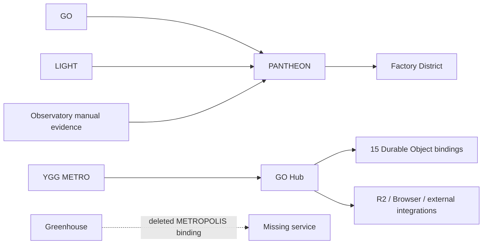
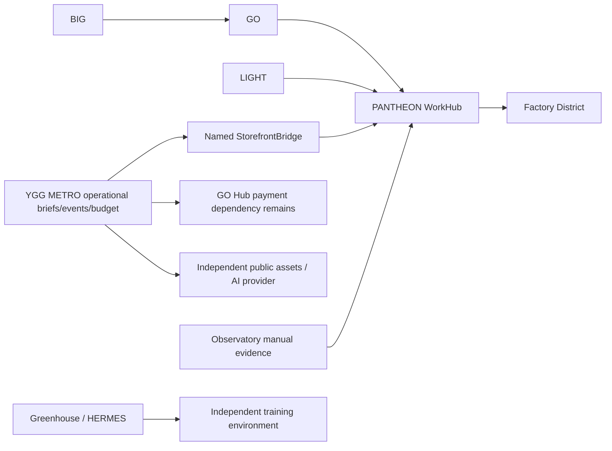

# PANTHEON rewiring — implementation and acceptance record

**GREEN: local implementation and integration. BLOCKED: production cutover and GO Hub retirement.** No deployment, merge, state deletion, secret change or billable service provisioning was performed.

## Before (observed bindings)



Observatory arrow represents the existing evidence integration, not a newly executed capture. See inventory for independent Workers and unknown callers.

## After (proposed; NOT deployed)



Public customer API contracts remain at the storefront. A signed HttpOnly customer-session principal scopes the named RPC receiver; public WorkHub HTTP does not expose it. This is not a general owner capability. Confirmation creates a queued owner-review task, never permission to execute tools. Brief IDs/work IDs and idempotent confirmation behavior are retained. Failed/uncertain writes never fall back automatically to the old backend. Payment calls remain on GO Hub deliberately: retirement is NOT complete.

The storefront branch builds on Draft #52. Receiver restores four missing MCP/OAuth deployment modules verified against deployed module SHA-256, preserving existing entrypoints. New SQL is additive and must be explicitly applied only after migration review. Both production gates default OFF (`BRIEF_REGISTRY_BACKEND=go-hub`, `STOREFRONT_INGRESS_ENABLED=false`).

## Reproduce local tests

Use Node 24.19 or compatible Node with node:sqlite. Clone both repositories into sibling directories `yggmetro-web` and `Pantheon-WorkHub`; check out the delivery branches. Clone the repositories listed in `caller-revisions.json` under sibling `callers/` and check out those exact hashes. No Cloudflare credentials are required for local tests.

```sh
cd yggmetro-web
npm ci
npm test
npm run test:pantheon
cd ../Pantheon-WorkHub
node --test cloudflare/tests/*.test.mjs
../yggmetro-web/node_modules/.bin/wrangler deploy --config cloudflare/production/wrangler.jsonc --dry-run --outdir /tmp/pantheon-rewire-bundle
```

`PANTHEON_SOURCE_DIR` and `REWIRE_CALLER_ROOT` override sibling checkout paths. The integration runs actual local workerd named entrypoints, SQLite-backed D1 and local R2 with real Factory LOGIC code. GO trusted identity is a local fixture, NOT a production authorization verification. `evidence/local-integration.json` identifies these limits. Existing production receipt metadata is historical readback, NOT evidence of executing the new migration. Browser Rendering, public checkout and fresh Observatory manual capture were not end-to-end verified in this stage.

## Migration, rollback and retirement gates

1. Owner reconciles unknown external clients, OAuth registrations/webhooks, queue producers, alarms and all GO Hub endpoints. Keep a caller ledger with last-seen and owner signoff; absence from this account's binding list is insufficient.
2. Preserve/export original DO/R2 state using authorized tooling; hash and verify an encrypted off-repository backup plus restore rehearsal. Missing `hubcentre` requires an incident/data-owner decision. No production export has been performed here.
3. Freeze brief writes for a reviewed maintenance interval. Export brief/work/event/budget records, validate counts/content hashes and reconcile old anonymous identity to signed sessions through an owner-approved claim process. Client-supplied clientId/conversationId alone cannot prove ownership. Import/export tooling and this identity migration remain a release blocker; do not switch on a fresh empty D1 database.
4. Review additive `0004_storefront.sql`, take D1 backup, apply in staging, verify old/current schema and receipt relations. Set an independently generated BRIEF_SESSION_KEY secret at storefront without committing its value. Deploy receiver then named binding only with owner approval; gates remain off until data and integration acceptance.
5. Verify production GO/LIGHT auth and Factory receipts, customer draft/confirm/replay/conflict, public denial, payment behavior, and a newly user-triggered Observatory snapshot. Record concrete readback IDs and deployed versions.
6. Enable receiver then storefront mode only after explicit owner-approved migration. Monitor errors, ownership conflicts and duplicate tasks. Preserve old deployment/config versions.
7. Rollback is a data procedure: freeze writes, export/reconcile new PANTHEON records back to old registry, verify task/receipt associations and ownership, then restore legacy flag/version. Flag reversal alone can hide new customer records and is NOT accepted rollback readiness. No automatic dual write or fallback is implemented.
8. Move payments to an independently approved payment backend and verify it before removing GO_HUB binding. Do not funnel payment-provider authorization through general WorkHub tasks.
9. Independently migrate/preserve Google/Notion, auth/passkeys, audit and Browser capabilities. Review/stop persistent alarms only with explicit approval after caller migration, verify a full observation window and backup restore.
10. Obtain BIG's explicit decommission approval with zero unresolved callers and complete state ownership. Only then retire Worker/namespaces/secrets/storage according to retention policy. This PR grants no such approval.

## Usage and cost evidence

Window: 2026-10-10 00:00 UTC inclusive through 2026-10-17 00:00 UTC exclusive. Adaptive analytics are operational measurements, not invoices. GO Hub had 6,058 Worker requests while DO traffic includes Centre 622,483 (29,000 errors), Global Audit 381,713 (31,886 errors), Lighthouse Control 28,455 (279 errors), FactoryEye 6,002, FactoryState 5 and Broadcast 1. Centre/Lighthouse alarm groups demonstrate that changing storefront calls alone will not stop background activity. Global Audit includes 30,819 exceededMemory outcomes and 336,932,860 stored SQL bytes in the observed storage sample.

`durable-types.json` documents CPU microseconds and duration GB-seconds; counts include internal invocations and cannot be equated to customer sessions. Billing history access returned Authentication error 10000. **Dollar savings estimate BLOCKED**: invoice/plan, included quotas, regional pricing and post-migration usage are unavailable. Supported estimate is only conditional: eliminated billable requests + eliminated duration + approved storage retirement at the account's actual marginal rates. Retained state, alarms and independent capabilities continue consuming resources. No claim that all account Durable Object charges come from GO Hub is made.

## Evidence and limits

`INVENTORY.md` enumerates every binding and all 20 DO namespaces. Attached JSON contains sanitized configuration, source module hashes, resource/routes/queue metadata, paginated object counts, usage and historical receipt readback. Local test logs and bundle logs are in `evidence/`. Production acceptance remains BLOCKED; broken service targets and missing R2 are RED. No service is declared safe to delete.

## Delivery

Receiver Draft PR: https://github.com/pureekangraw-ops/Pantheon-WorkHub/pull/11 (initial implementation 89fb16a). Storefront Draft PR: https://github.com/pureekangraw-ops/yggmetro-web/pull/53 (86e9988), built on #52. Branches: `feat/storefront-brief-ingress-20261017` and `refactor/pantheon-brief-routing-20261017`.

Read-only Observatory request returned upstream 200 / NO_FRESH_SNAPSHOT at epoch 1792200262973. No capture was triggered; a new owner-triggered Send page round is required for acceptance. Local reviewer confirmed the principal-scoped budget fix and found no remaining reproducible Critical/Important issue in reviewed scope. CI results are separate from the attached local results.
